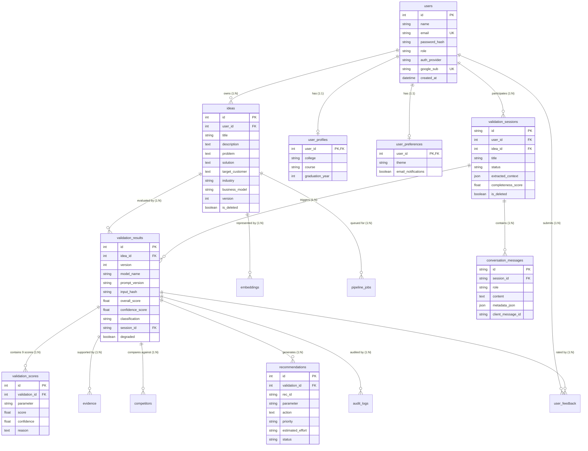

# 06. Database Architecture & Schema Audit

This document details the relational database architecture, table schemas, entity relationships, foreign key constraints, indexing strategies, and Alembic migrations.

---

## 1. Database Engines & Connection Management

The application supports dual database engines configured in `backend/app/database/connection.py`:

| Environment | Database Engine | Driver | Configuration & Connection Args |
| :--- | :--- | :--- | :--- |
| **Development** | **SQLite 3** (`startup_validation.db`) | Built-in Python `sqlite3` | `connect_args={"check_same_thread": False}`, `pool_pre_ping=True` |
| **Testing** | **SQLite 3** in-memory / file (`test.db`) | Built-in Python `sqlite3` | Isolated session per test run |
| **Production** | **PostgreSQL 16** (`postgres:16-alpine`) | `psycopg2-binary` | Standard connection pooling, transactional DDL, ACID compliance |

The connection engine is instantiated via:
```python
connect_args = {}
if settings.DATABASE_URL.startswith("sqlite"):
    connect_args = {"check_same_thread": False}

engine = create_engine(
    settings.DATABASE_URL,
    connect_args=connect_args,
    pool_pre_ping=True
)
SessionLocal = sessionmaker(autocommit=False, autoflush=False, bind=engine)
```

---

## 2. Complete Entity-Relationship (ER) Diagram



---

## 3. Comprehensive Table Schema Inventory

### 1. `users` Table (`backend/app/models/user.py`)
- Primary table for user identities and credentials.
- **Columns**:
  - `id`: `Integer`, Primary Key, autoincrement, indexed.
  - `name`: `String(100)`, nullable=False.
  - `email`: `String(255)`, unique=True, indexed, nullable=False.
  - `password_hash`: `String(255)`, nullable=True (null for Google OAuth users).
  - `role`: `String(20)`, default="USER", nullable=False (`USER` or `ADMIN`).
  - `auth_provider`: `String(20)`, default="LOCAL", nullable=False (`LOCAL` or `GOOGLE`).
  - `google_sub`: `String(100)`, unique=True, indexed, nullable=True.
  - `profile_image`: `String(500)`, nullable=True.
  - `last_login_at`: `DateTime`, nullable=True.
  - `created_at`: `DateTime`, default=datetime.utcnow, nullable=False.
  - `updated_at`: `DateTime`, default=datetime.utcnow, onupdate=datetime.utcnow, nullable=False.
- **Cascades**: Deleting a user cascade-deletes their `ideas`, `profile`, `preferences`, and `sessions`.

### 2. `user_profiles` Table (`backend/app/models/profile.py`)
- One-to-one academic profile for collegiate founders.
- **Columns**:
  - `user_id`: `Integer`, ForeignKey(`users.id`, ondelete="CASCADE"), Primary Key.
  - `college`: `String(255)`, nullable=True.
  - `course`: `String(255)`, nullable=True.
  - `graduation_year`: `Integer`, nullable=True.
  - `created_at`: `DateTime`, default=datetime.utcnow, nullable=False.
  - `updated_at`: `DateTime`, default=datetime.utcnow, nullable=False.

### 3. `user_preferences` Table (`backend/app/models/profile.py`)
- One-to-one user application preferences.
- **Columns**:
  - `user_id`: `Integer`, ForeignKey(`users.id`, ondelete="CASCADE"), Primary Key.
  - `theme`: `String(20)`, default="light", nullable=False (`light`, `dark`, `system`).
  - `email_notifications`: `Boolean`, default=True, nullable=False.
  - `created_at`, `updated_at`: `DateTime`.

### 4. `ideas` Table (`backend/app/models/idea.py`)
- Core repository of founder venture concepts.
- **Columns**:
  - `id`: `Integer`, Primary Key, indexed.
  - `user_id`: `Integer`, ForeignKey(`users.id`, ondelete="CASCADE"), nullable=False.
  - `title`: `String(255)`, nullable=False.
  - `description`: `Text`, nullable=False.
  - `problem`: `Text`, nullable=True.
  - `target_customer`: `Text`, nullable=True.
  - `solution`: `Text`, nullable=True.
  - `industry`: `String(100)`, nullable=True.
  - `business_model`: `String(100)`, nullable=True.
  - `revenue_model`: `String(100)`, nullable=True.
  - `pricing`: `String(100)`, nullable=True.
  - `technology`: `Text`, nullable=True.
  - `version`: `Integer`, default=1, nullable=False (Synchronized with latest report version).
  - `is_deleted`: `Boolean`, default=False, nullable=False (Soft-delete flag).
  - `deleted_at`: `DateTime`, nullable=True.
  - `webhook_url`: `Text`, nullable=True.
  - `created_at`, `updated_at`: `DateTime`.

### 5. `validation_sessions` Table (`backend/app/models/chat.py`)
- Manages interactive conversational AI validation sessions.
- **Columns**:
  - `id`: `String(64)`, Primary Key (UUIDv4).
  - `user_id`: `Integer`, ForeignKey(`users.id`, ondelete="CASCADE"), indexed, nullable=False.
  - `idea_id`: `Integer`, ForeignKey(`ideas.id`, ondelete="SET NULL"), indexed, nullable=True.
  - `title`: `String(255)`, default="New Startup Idea", nullable=False.
  - `status`: `String(30)`, default="active", nullable=False (`active`, `processing`, `completed`, `failed`).
  - `extracted_context`: `JSON`, default=dict, nullable=False (holds rolling entity extraction).
  - `completeness_score`: `Float`, default=0.0, nullable=False (0.0 to 100.0).
  - `is_deleted`: `Boolean`, default=False, nullable=False.
  - `created_at`, `updated_at`: `DateTime`.

### 6. `conversation_messages` Table (`backend/app/models/chat.py`)
- Individual dialogue turns within a validation session.
- **Columns**:
  - `id`: `String(64)`, Primary Key (UUIDv4).
  - `session_id`: `String(64)`, ForeignKey(`validation_sessions.id`, ondelete="CASCADE"), indexed.
  - `role`: `String(20)`, nullable=False (`user`, `assistant`, `system`).
  - `content`: `Text`, nullable=False.
  - `metadata_json`: `JSON`, nullable=True (stores `actionType`, `suggestions`, etc.).
  - `client_message_id`: `String(100)`, nullable=True (Used for request idempotency).
  - `created_at`: `DateTime`, indexed, default=datetime.utcnow.
- **Unique Constraint**: `uq_session_client_message_id` on `("session_id", "client_message_id")`.

### 7. `validation_results` Table (`backend/app/models/validation.py`)
- Immutable historical validation records.
- **Columns**:
  - `id`: `Integer`, Primary Key, indexed.
  - `idea_id`: `Integer`, ForeignKey(`ideas.id`, ondelete="CASCADE"), nullable=False.
  - `version`: `Integer`, default=1, nullable=False.
  - `model_name`: `String(100)`, nullable=False (`gemini-pro`, `mock-llm`).
  - `model_version`: `String(50)`, nullable=False.
  - `prompt_version`: `String(50)`, default="v1.3", nullable=False.
  - `embedding_model_version`: `String(50)`, default="all-MiniLM-L6-v2-v1.0".
  - `scoring_version`: `String(50)`, default="v2.0".
  - `input_hash`: `String(64)`, nullable=False (SHA-256 of canonical inputs).
  - `overall_score`: `Float`, nullable=False (0.0 - 100.0).
  - `confidence_score`: `Float`, nullable=False (0.0 - 100.0).
  - `confidence_breakdown`: `JSON`, nullable=True.
  - `score_overrides`: `JSON`, nullable=True (Records overrides applied by Layer 8).
  - `rules_version`: `String(50)`, default="v1".
  - `category`: `String(50)`, nullable=True.
  - `sample_spread`: `JSON`, nullable=True.
  - `classification`: `String(50)`, nullable=False (`EXCEPTIONAL`, `STRONG`, `MODERATE`, `WEAK`, `VERY_WEAK`).
  - `pipeline_timing`: `JSON`, nullable=True (Milliseconds per layer).
  - `session_id`: `String(64)`, ForeignKey(`validation_sessions.id`, ondelete="SET NULL"), indexed.
  - `framework_version`: `String(20)`, default="v1.0", nullable=False.
  - `generation_mode`: `String(30)`, default="ai_standard", nullable=False.
  - `degraded`: `Boolean`, default=False, nullable=False (True if generated via fallback).
  - `inputs_changed`: `JSON`, nullable=True.
  - `summary`, `strategic_verdict`, `recommended_action`: `Text`.
  - `analysis_json`: `JSON`, nullable=True.
  - `created_at`: `DateTime`, default=datetime.utcnow.
- **Unique Constraint**: `uq_validation_result_idea_version` on `("idea_id", "version")`.

### 8. `validation_scores` Table (`backend/app/models/score.py`)
- Stores individual parameter scores (9 rows per validation).
- **Columns**: `id`, `validation_id` (FK cascade), `parameter`, `score`, `confidence`, `reason`.

### 9. `recommendations` Table (`backend/app/models/recommendation.py`)
- Structured improvement actions.
- **Columns**: `id`, `rec_id`, `validation_id` (FK cascade), `parameter`, `current_score`, `severity`, `root_cause`, `missing_information`, `objective`, `action`, `category`, `priority`, `success_metric`, `estimated_effort`, `actionability`, `status` (`OPEN` / `COMPLETED`).

### 10. `competitors` Table (`backend/app/models/competitor.py`)
- Competitor benchmarks.
- **Columns**: `id`, `validation_id` (FK cascade), `name`, `similarity_score`, `target_customer`, `business_model`, `pricing`, `differentiator`, `source_url`.

### 11. `evidence` Table (`backend/app/models/evidence.py`)
- Evidence and citations.
- **Columns**: `id`, `validation_id` (FK cascade), `source_name`, `source_url`, `retrieved_at`, `claim`, `claim_type`, `evidence_summary`, `reliability` (`VERIFIED`, `ESTIMATED`, `GENERATED`, `UNKNOWN`).

### 12. `embeddings` Table (`backend/app/models/embedding.py`)
- Vector embeddings reference.
- **Columns**: `id`, `idea_id` (FK cascade), `model_name`, `vector_reference` (JSON array of 384 floats), `created_at`.

### 13. `pipeline_jobs` Table (`backend/app/models/pipeline_job.py`)
- Celery asynchronous job tracking.
- **Columns**: `id`, `idea_id` (FK cascade), `celery_task_id` (unique, indexed), `status` (`PENDING`, `RUNNING`, `COMPLETED`, `FAILED`), `result_id` (FK), `created_at`, `completed_at`.

### 14. `audit_logs` Table (`backend/app/models/audit_log.py`)
- Audit trail.
- **Columns**: `id`, `validation_id` (FK cascade), `event`, `metadata` (JSON), `timestamp`.

### 15. `user_feedback` Table (`backend/app/models/user_feedback.py`)
- Founder score accuracy feedback.
- **Columns**: `id`, `result_id` (FK cascade), `user_id` (FK cascade), `direction` (`too_high`, `too_low`, `accurate`), `reason`, `created_at`.

---

## 4. Alembic Migration History

Located in `backend/alembic/versions/`:

1. `c2c779c35412_initial_schema.py`: Initial schema creation (`users`, `ideas`, `validation_results`, `scores`, `evidence`, `competitors`, `recommendations`, `embeddings`, `audit_logs`).
2. `c1d2e3f4a5b6_phase1_versioning_feedback.py`: Added `user_feedback` table and versioning refinements.
3. `a3c4d5e6a7b8_add_confidence_breakdown.py`: Added `confidence_breakdown` JSON column to `validation_results`.
4. `e1a2b3c4d5e6_add_score_overrides.py`: Added `score_overrides` JSON column to `validation_results`.
5. `f2b3c4d5e6a7_add_evidence_traceability.py`: Added `claim_type` and `reliability` columns to `evidence`.
6. `b4d5e6a7b8c9_add_version_pinning_columns.py`: Added `prompt_version`, `embedding_model_version`, `scoring_version`, `rules_version` columns.
7. `d4e5f6a7b8c9_chat_sessions_and_profile_extensions.py`: Added `validation_sessions`, `conversation_messages`, `user_profiles`, `user_preferences`, and Google OAuth fields.
