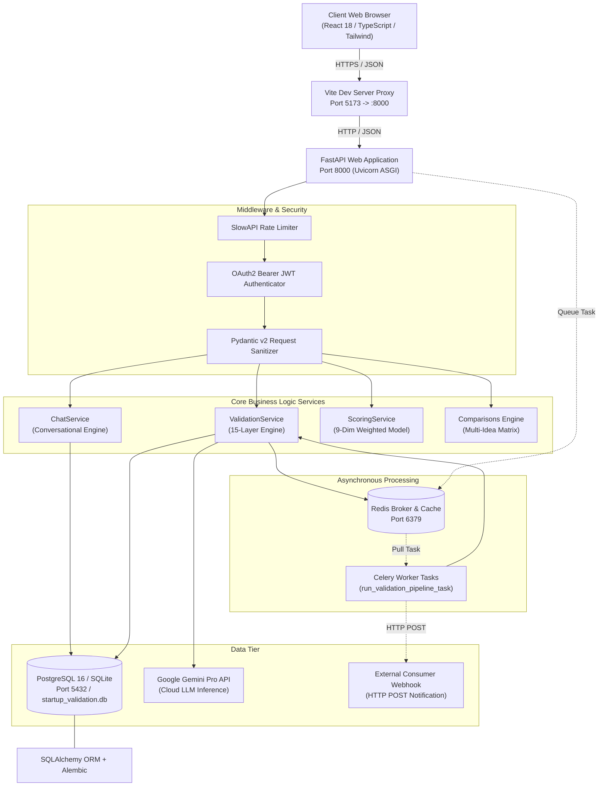
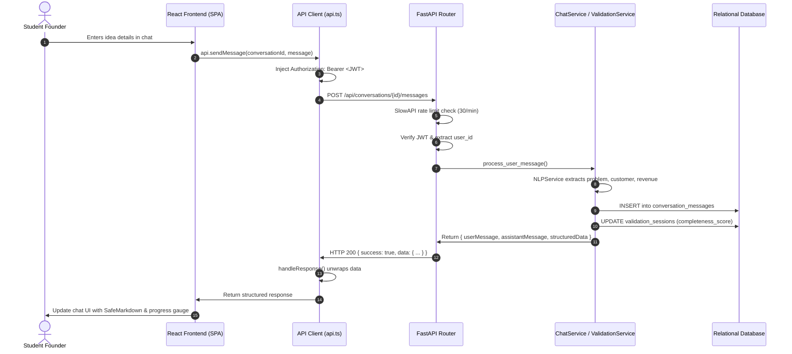
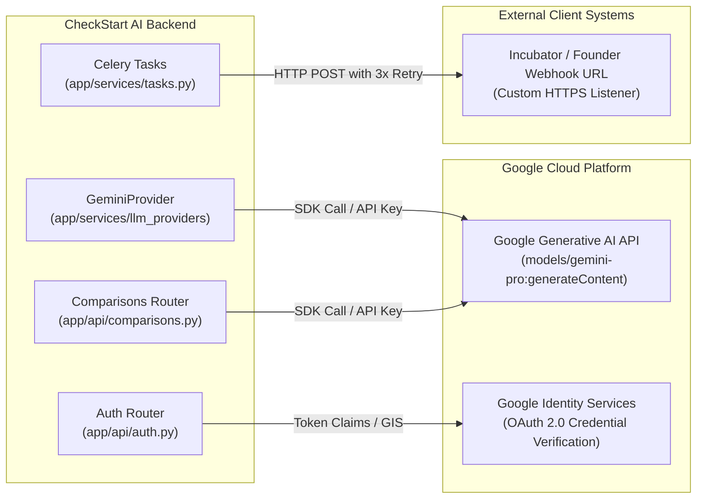
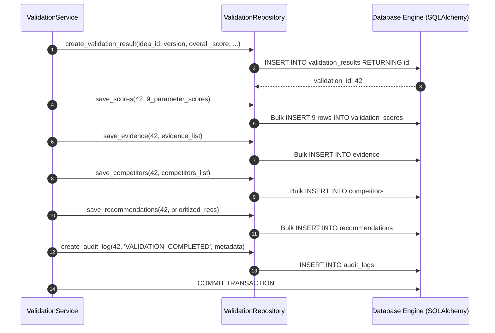
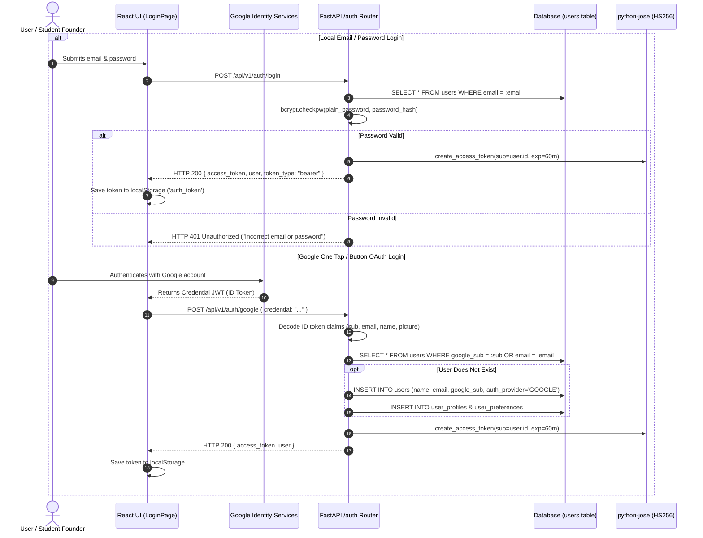
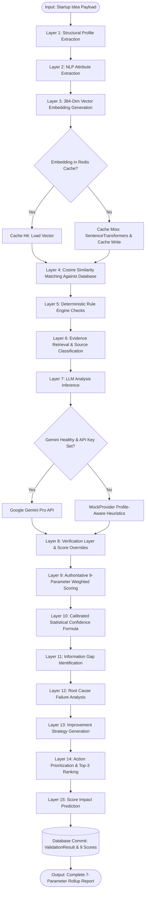
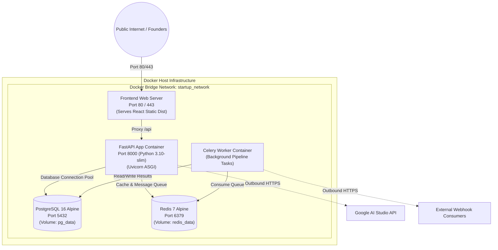

# 10. System Architecture & Data Flow Diagrams

This document illustrates the end-to-end technical architecture, network boundaries, protocol flows, and data transitions of CheckStart AI using 7 detailed Mermaid diagrams.

---

## 1. High-Level System Architecture

---

## 2. Frontend-to-Backend Communication Diagram

---

## 3. Third-Party API Integration Diagram

---

## 4. Database Interaction & Model Relationship Diagram

---

## 5. Authentication Flow Diagram (Local & Google OAuth)

---

## 6. AI/ML 15-Layer Pipeline Flow Diagram

---

## 7. Containerized Deployment Architecture Diagram

