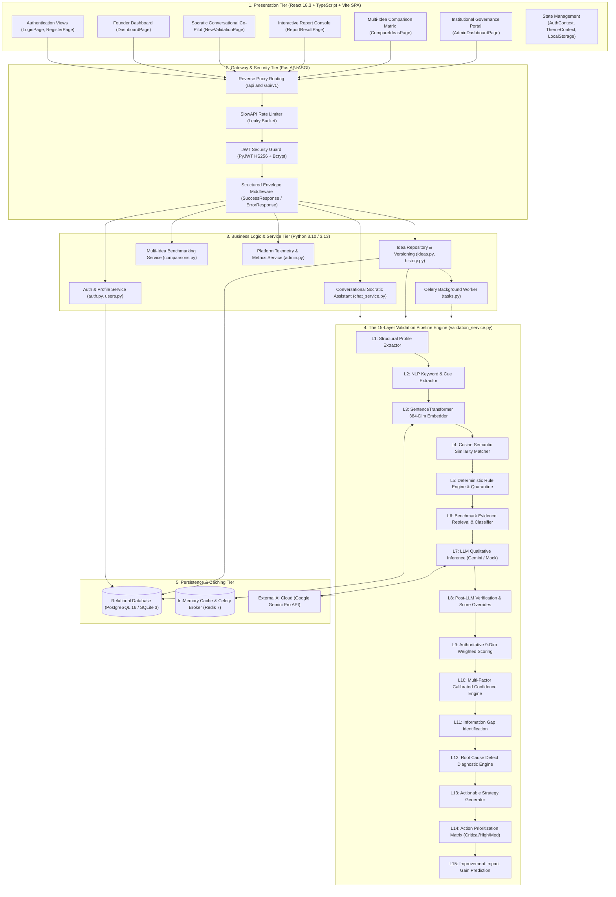
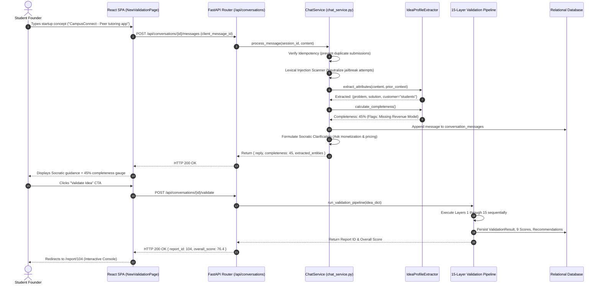
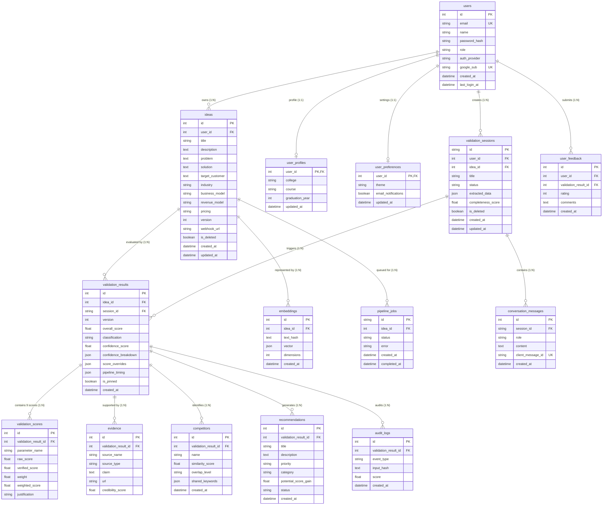
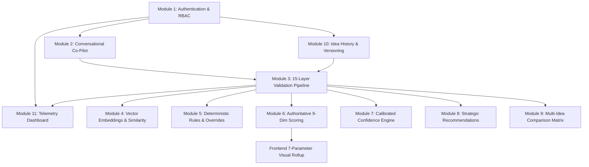

# CheckStart AI: Academic Report Diagrams Source (Mermaid)

This document contains the complete, editable Mermaid diagram sources for all architectural, procedural, and relational figures included in the academic project report for **CheckStart AI: AI-Assisted Startup Idea Validation and Strategic Recommendation Platform**.

---

## Figure 3.1: Overall System Architecture (Multi-Tier)

---

## Figure 3.2: The 15-Layer Sequential Validation Pipeline

```mermaid
flowchart TD
    INPUT(["Raw Startup Idea Input"]) --> L1["Layer 1: Structural Profile Extractor<br/>(Parses fields, checks completeness, flags vagueness)"]
    L1 --> L2["Layer 2: NLP Attribute & Cue Extractor<br/>(Stopword stripping, 10 keywords, regex problem/solution cues)"]
    L2 --> L3["Layer 3: Dense Vector Embeddings<br/>(SentenceTransformer all-MiniLM-L6-v2, 384-dim, Redis cache)"]
    L3 --> L4["Layer 4: Semantic Similarity Matcher<br/>(Cosine similarity against peer ideas, competitor overlap detection)"]
    L4 --> L5["Layer 5: Deterministic Rule Engine<br/>(Length bounds [10, 3000 words], prompt injection quarantine)"]
    L5 --> L6["Layer 6: Benchmark Evidence Retrieval<br/>(Source provenance classification: Verified, Estimated, Generated)"]
    L6 --> L7["Layer 7: LLM Reasoning Inference<br/>(Prompt v1.3 with Google Gemini Pro or MockProvider fallback)"]
    L7 --> L8["Layer 8: Post-LLM Verification Guardrail<br/>(Anti-flattery score overrides: caps missing revenue/customer/fraud)"]
    L8 --> L9["Layer 9: Authoritative 9-Dim Scoring<br/>(Deterministic weighted sum = 1.000, 7-param visual rollup)"]
    L9 --> L10["Layer 10: Calibrated Confidence Engine<br/>(Base formula - override/evidence/mock/length deductions)"]
    L10 --> L11["Layer 11: Information Gap Scanner<br/>(Detects missing unit economics, pricing elasticity, CAC/LTV)"]
    L11 --> L12["Layer 12: Root Cause Defect Diagnosis<br/>(Deep diagnostic mapping from weak sub-scores to operational defects)"]
    L12 --> L13["Layer 13: Actionable Strategy Generator<br/>(Formulates concrete Lean Startup validation experiments)"]
    L13 --> L14["Layer 14: Action Prioritization Matrix<br/>(Categorizes into Critical, High, Med; extracts Top-3 Actions)"]
    L14 --> L15["Layer 15: Impact Gain Prediction<br/>(Predicts anticipated score delta upon completing recommendations)"]
    L15 --> OUTPUT(["Output: Immutable ValidationResult Persisted in DB"])
```

---

## Figure 3.3: Conversational Socratic Dialogue & Inception Sequence

---

## Figure 3.4: Complete Database Entity-Relationship (ER) Model

---

## Figure 3.5: Module Dependency & Component Hierarchy

